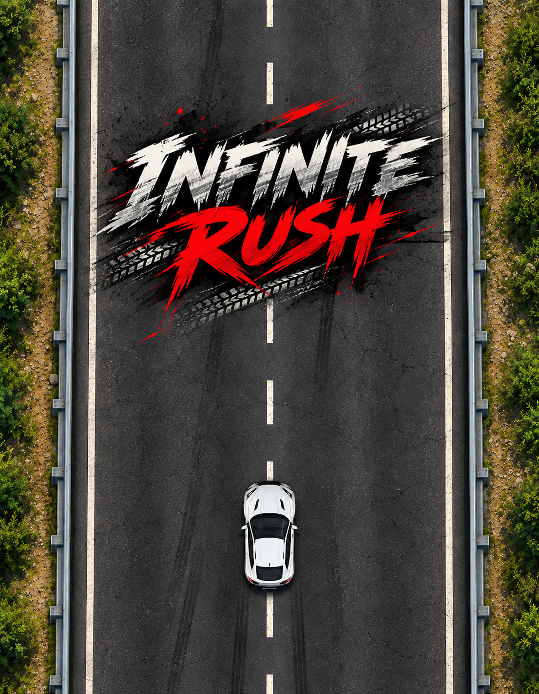

# 🏎️ Infinite Rush

> **How long can you survive the rush?**

**Infinite Rush** is a 2D endless car racing game built with **Python and Pygame**.

Drive through an endless highway, avoid incoming traffic, survive as long as possible, and beat your high score.

## 🎮 Gameplay

The road never ends.

Your objective is simple:

**Avoid the traffic. Survive. Score higher.**

As you progress, the game becomes faster and more challenging. One collision ends the run.

## ✨ Features

- 🏎️ Player-controlled racing car
- 🛣️ Infinite scrolling highway
- 🚗 Randomly spawning enemy vehicles
- 💥 Collision detection
- 📈 Increasing difficulty
- 🏆 Persistent high-score system
- 🎵 Background music
- 🔊 Game-over sound effects
- 🎨 Custom game graphics
- 🖱️ Interactive main menu
- 🔄 Retry system
- 📦 Standalone Windows executable
- ⚡ Built with Pygame

## 🕹️ Controls

| Key | Action |
|---|---|
| `↑` | Move Up |
| `↓` | Move Down |
| `←` | Move Left |
| `→` | Move Right |

## 🏆 Scoring

Your score continuously increases while you survive.

The longer you stay on the road, the higher your score becomes.

The game also saves your **High Score** locally so you can try to beat your previous record.

## 🚀 Difficulty

The game gradually increases its speed as you survive.

At higher scores, the highway becomes significantly faster, making it harder to avoid incoming traffic.

> **Survive. Beat your score. Repeat.**

## 📸 Screenshots

### Main Menu



### Gameplay

*Gameplay screenshot coming soon.*

### Game Over

*Game-over screenshot coming soon.*

## 🛠️ Built With

- **Python**
- **Pygame**
- **PyInstaller**

## 📁 Project Structure

```text
Infinite-Rush/
│
├── assets/
│   ├── bg.png
│   ├── car.png
│   ├── icon.ico
│   ├── icon.png
│   ├── mainmenu.png
│   └── obs.png
│
├── saves/
│   └── save.txt
│
├── sounds/
│   ├── bgm.mp3
│   └── gameover.mp3
│
├── main.py
├── main.spec
└── README.md
```

## 💻 Running From Source

### Requirements

- Python 3.x
- Pygame

Install Pygame:

```bash
pip install pygame
```

Run the game:

```bash
python main.py
```

## 📦 Windows Build

A standalone Windows executable can be created using PyInstaller:

```bash
pyinstaller main.spec
```

The generated executable does not require Python or Pygame to be installed on the target machine.

## 🎯 Future Plans

- [ ] More enemy vehicles
- [ ] Multiple playable cars
- [ ] Different highways
- [ ] Difficulty modes
- [ ] Pause system
- [ ] Settings menu
- [ ] More sound effects
- [ ] Better score system
- [ ] Online leaderboard

## 👨‍💻 Developer

**Lucky Kumar**

Created as an independent game development project using Python and Pygame.

## 📜 License

This project is currently provided for educational and personal use.

---

### ⭐ If you enjoy the game, consider starring the repository!
